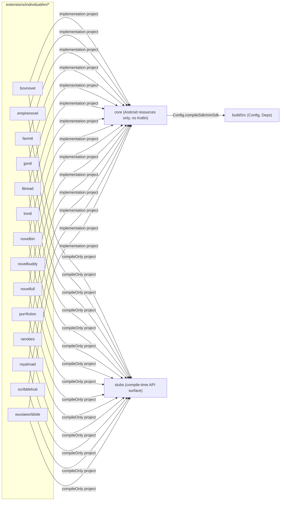
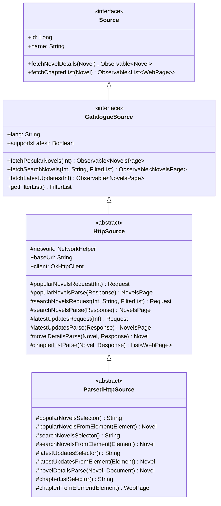

# Code Graph — NovelLibrary-Extensions

Machine-oriented dependency and inheritance graph for this repository. Pairs with
`KOTLIN_INDEX.md` (which has full file/signature detail). This file focuses on
**edges**: what depends on / extends / calls what.

---

## 1. Module dependency graph

**Build script chain per extension:**
`extensions/individual/en/<name>/build.gradle`
  → `apply from: "$rootDir/common.gradle"`
    → `dependencies { implementation project(":core") }`
    → `apply from: "$rootDir/common-dependencies.gradle"`
      → `compileOnly project(':stubs')` + third-party `compileOnly` libs (okhttp, rxjava, jsoup, gson, kotson, injekt-core)

Key fact: `stubs` is **compileOnly** — its classes throw `Exception("Stub!")` at runtime.
The real implementations are provided by the host NovelLibrary app when it loads the
extension APK. `core` is **implementation** and contributes no code, only
`AndroidManifest.xml` + app icon resources. `stubs` and `core` do not depend on each other.

---

## 2. Class inheritance graph (stubs)

`ParsedHttpSource` re-stubs the `Response`-based parse methods inherited from `HttpSource`
(they throw `Exception("Stub!")`) and replaces them with `Document`/`Element`-based Jsoup
contracts. Any extension extending `ParsedHttpSource` must NOT rely on the raw `Response`
parse hooks — it must implement the `*Selector()` / `*FromElement()` contracts instead.

---

## 3. Extension → base class edges

| Extension class | extends | File |
|---|---|---|
| `BoxNovel` | `ParsedHttpSource` | `extensions/individual/en/boxnovel/src/.../BoxNovel.kt` |
| `EmpireNovel` | `ParsedHttpSource` | `extensions/individual/en/empirenovel/src/.../EmpireNovel.kt` |
| `FanMTL` | `ParsedHttpSource` | `extensions/individual/en/fanmtl/src/.../FanMTL.kt` |
| `JPMTL` | `ParsedHttpSource` | `extensions/individual/en/jpmtl/src/.../JPMTL.kt` |
| `LibRead` | `ParsedHttpSource` | `extensions/individual/en/libread/src/.../LibRead.kt` |
| `LNMTL` | `ParsedHttpSource` | `extensions/individual/en/lnmtl/src/.../LNMTL.kt` |
| `NovelBin` | `ParsedHttpSource` | `extensions/individual/en/novelbin/src/.../NovelBin.kt` |
| `NovelBuddy` | `HttpSource` | `extensions/individual/en/novelbuddy/src/.../NovelBuddy.kt` |
| `NovelFull` | `ParsedHttpSource` | `extensions/individual/en/novelfull/src/.../NovelFull.kt` |
| `PurrFiction` | `HttpSource` | `extensions/individual/en/purrfiction/src/.../PurrFiction.kt` |
| `Ranobes` | `ParsedHttpSource` | `extensions/individual/en/ranobes/src/.../Ranobes.kt` |
| `RoyalRoad` | `ParsedHttpSource` | `extensions/individual/en/royalroad/src/.../RoyalRoad.kt` |
| `ScribbleHub` | `ParsedHttpSource` | `extensions/individual/en/scribblehub/src/.../ScribbleHub.kt` |
| `WuxiaWorldSite` | `ParsedHttpSource` | `extensions/individual/en/wuxiaworldsite/src/.../WuxiaWorldSite.kt` |

12/14 extend `ParsedHttpSource` (HTML scraping via Jsoup). 2/14 (`NovelBuddy`, `PurrFiction`)
extend `HttpSource` directly because the target sites are JSON APIs, parsed with Gson.

---

## 4. Import / reference edges (extensions → stubs)

Every extension file imports from `stubs`. Aggregate edge list (module-level, not per-file
since the pattern is nearly universal — see `KOTLIN_INDEX.md` §"Shared utility usage" for
which specific extensions use the non-universal ones):

| From (all 14 extensions) | To (stubs symbol) | Edge type |
|---|---|---|
| `<Extension>` class | `model.source.online.HttpSource` or `.ParsedHttpSource` | extends |
| `<Extension>` class | `model.database.Novel` | uses (param/return type) |
| `<Extension>` class | `model.database.WebPage` | uses (param/return type) |
| `<Extension>` class | `model.other.NovelsPage` | uses (return type) |
| `<Extension>` class | `model.source.filter.FilterList` | uses (param type) |
| `<Extension>` class | `network.Requests.GET` / `.POST` | calls |
| `<Extension>` class | `util.network.JsoupExtensions.asJsoup` | calls (ParsedHttpSource-based only) |
| `<Extension>` class | `util.Exceptions.*` | references (constants, in stubbed methods) |

Non-universal edges (subset of extensions):

| Extension(s) | stubs symbol | Edge type |
|---|---|---|
| lnmtl, purrfiction | `util.network.OkHttpExt.safeExecute` | calls |
| ranobes, purrfiction | `util.lang.JavaLangExt.asJsonNullFreeString` / `.asJsonNullFree` | calls |
| purrfiction | `util.system.Base64Ext.encodeBase64ToString` | calls |

---

## 5. Third-party library edges (extensions → external)

| Library | Used by | Purpose |
|---|---|---|
| `org.jsoup.nodes.{Document,Element}` | all `ParsedHttpSource` extensions (12) | HTML parsing |
| `okhttp3.{Headers,OkHttpClient,Request,Response,FormBody}` | all 14 extensions | HTTP layer types |
| `com.google.gson.*` (JsonObject, JsonParser, SerializedName, LinkedTreeMap, TypeToken) | novelbuddy, lnmtl, purrfiction, ranobes, jpmtl | JSON parsing |
| `org.json.JSONArray` | empirenovel | JSON parsing |

---

## 6. Notable dead/inconsistent edges

- `buildSrc/src/main/kotlin/Deps.kt` defines `okhttp = 3.10.0`, but
  `common-dependencies.gradle` hardcodes a different version (`5.0.0-alpha.2`) for the
  actual extension builds. `Deps.kt` is effectively unreferenced by the Groovy build
  scripts — flag as dead code if cleaning up build logic.
- `core/build.gradle.kts` is the only Kotlin-DSL build script in the module tree that
  actually references `buildSrc.Config`; all other build files are Groovy and read
  constants from root-level `common.gradle` instead.

---

## 7. Stubbed / unimplemented method edges (behavioral note)

Most extensions override `popularNovels*()` and `latestUpdates*()` only to throw
`Exception(Exceptions.MISSING_IMPLEMENTATION)` or `Exception(Exceptions.NOT_USED)`. This is
a real, intentional edge in the call graph: the host app's "browse popular/latest" UI paths
will hit a thrown exception for most extensions in this repo. `searchNovels*`,
`novelDetailsParse`, and `chapterList*`/`chapterFromElement` are fully wired end-to-end for
every extension.

**Exception: `NovelBuddy`** fully implements `popularNovels*`/`latestUpdates*` against its
JSON API's `sort=popular`/`sort=latest` query params, and sets `supportsLatest = true` — it
is the only extension in the repo with working popular/latest browsing.
